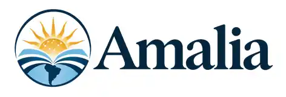

<h1 align="center">
  
</h1>

<h2 align="center">The future has a memory, too.</h2>

An Argentine open artificial intelligence project.

<a href="docs/technical-design.md">Technical design (ES)</a> · <a href="docs/sponsorship.md"><strong>Institutional sponsorship (ES)</strong></a> · <a href="CONTRIBUTING.md">Contribute (ES)</a> · <a href="README.md">Español</a>

---

**Project status:** founding stage · open research · first experimental release in planning.

Amalia explores how a language model's learned representation of the world can change through deliberate incorporation of a society's cultural, scientific, linguistic and intellectual heritage.

Inspired by José Mármol's serialized novel *Amalia* (1851; complete edition 1855) and Jorge Luis Borges's *The Aleph*, the initiative brings together software engineering, semiotics, communication and cultural memory. The literary analogy is not a claim that models contain all knowledge or possess human experience.

We will start with small open models, carefully audited corpora, controlled continual-pretraining experiments and comparative evaluation. Our first public experimental release will aim to include weights, redistributable data, code, methods and a call for voluntary contributions. Larger and frontier models are long-term research aspirations, conditional on evidence and resources.

Our principles are openness, sovereignty, cultural diversity, federal participation, pluralism, scientific rigor, responsible data use and continuity independent of any founder or sponsor.

## Build Amalia with us

We are seeking a founding sponsor and academic, cultural and technology partners to support a reproducible research laboratory and our first public experimental release. Contributions may include computing resources, funding, scientific expertise and connections to cultural institutions and communities. Scientific independence and open access remain fundamental.

[Institutional sponsorship proposal (Spanish)](docs/sponsorship.md) · [Get involved](https://github.com/diegocofre/amalia/issues/new)

We welcome researchers, engineers, authors, educators, cultural institutions, communities and infrastructure or funding partners. No institutional participation is yet confirmed. Please propose ideas and sources through repository issues; do not upload documents without verified permissions or personal information.

See the [Spanish README](README.md), [roadmap](ROADMAP.md), [research agenda](docs/research.md), [technical design (Spanish)](docs/technical-design.md), [licensing policy](docs/licensing.md), [governance](GOVERNANCE.md) and [contribution guide](CONTRIBUTING.md).
