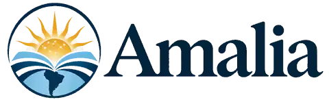

  <picture>
    <source media="(prefers-color-scheme: dark)" srcset="assets/amalia-logo-dark.webp">
    <source media="(prefers-color-scheme: light)" srcset="assets/amalia-logo-light.webp">
    
  </picture>

<h2 align="center">Inteligencia abierta, nacida al sur.</h2>

Proyecto argentino de inteligencia artificial abierta.

  <a href="#qué-es-amalia">El proyecto</a> &nbsp;·&nbsp;
  <a href="docs/technical-design.md">Diseño técnico</a> &nbsp;·&nbsp;
  <a href="docs/sponsorship.md"><strong>Patrocinio</strong></a> &nbsp;·&nbsp;
  <a href="CONTRIBUTING.md">Sumate</a> &nbsp;·&nbsp;
  <a href="README.en.md">English</a>

---

> Lo que vieron mis ojos fue simultáneo: lo que transcribiré, sucesivo, porque el lenguaje lo es.
>
> — Jorge Luis Borges, *El Aleph*. [Fuente](https://www.iar.unlp.edu.ar/index.php/2022/06/28/fragmento-de-el-aleph/)

## ¿Qué conocimiento le estamos dejando al futuro?

Durante siglos, las sociedades encontraron distintas maneras de preservar y transmitir su conocimiento. La escritura, la imprenta, las bibliotecas, los medios de comunicación e Internet transformaron nuestra relación con la cultura y la memoria colectiva.

Hoy, los modelos de lenguaje inauguran otra forma de representar y producir sentido a partir de grandes cantidades de textos. No todas las culturas, comunidades y tradiciones intelectuales están igualmente representadas en esos materiales.

¿Qué lugar ocupa nuestro patrimonio cultural en las inteligencias artificiales del futuro?

Amalia nace de esa inquietud.

Queremos que las voces de nuestra sociedad participen de la formación de las inteligencias artificiales del futuro. Y queremos que esa tecnología pueda ser estudiada, utilizada y desarrollada desde cualquier lugar del mundo.

## Qué es Amalia

Amalia es una iniciativa argentina de investigación abierta que busca construir una familia de modelos de lenguaje enriquecidos con el patrimonio cultural, científico, lingüístico e intelectual de nuestra sociedad, en diálogo con el conocimiento universal.

Queremos investigar cómo nuestra literatura, historia, ciencia, formas de comunicarnos y experiencias colectivas pueden modificar las representaciones aprendidas por un modelo. Queremos hacerlo de manera federal, participativa y científicamente rigurosa.

| Ciencia | Tecnología | Cultura y sociedad |
| :--- | :--- | :--- |
| Investigar cómo los datos culturales modifican los modelos de lenguaje. | Construir modelos abiertos, reproducibles y progresivamente más capaces. | Recuperar patrimonio y convocar a las comunidades de todo el país. |

### Nuestra pregunta fundacional

> **¿Hasta qué punto podemos modificar la representación del mundo de un modelo de lenguaje mediante la incorporación deliberada del patrimonio cultural, científico, lingüístico e intelectual de una sociedad?**

No buscamos imponer una personalidad mediante instrucciones. Queremos observar si ciertas características culturales emergen del propio aprendizaje, medirlas y comprenderlas, sin sacrificar la pluralidad ni ocultar resultados negativos.

## De Amalia al Aleph

En 1851, José Mármol comenzó a publicar *Amalia* por entregas en Montevideo. La edición completa apareció en Buenos Aires en 1855. Obra fundacional de la novela argentina, también constituye un hito en nuestra historia de la comunicación: la literatura encontró en la prensa periódica un medio para construir y transmitir cultura.

Casi un siglo después, Borges imaginó en *El Aleph* una multiplicidad simultánea que el lenguaje solo podía expresar sucesivamente. La tensión que describe el fragmento inicial encuentra una resonancia conceptual en los modelos de lenguaje: representaciones neuronales distribuidas a partir de las cuales se generan secuencias de tokens.

La analogía es literaria y semiótica, no una equivalencia técnica. Un modelo no contiene el universo, no conserva fielmente todos sus textos y puede equivocarse. Pero nos invita a preguntarnos qué voces y conocimientos están representados en él, y cuáles quedan afuera.

## Una construcción colectiva y federal

En cada rincón del país existen conocimientos, historias y experiencias que merecen ser preservados. En bibliotecas populares, archivos históricos, universidades, escuelas rurales, centros culturales y comunidades existe patrimonio que no siempre está digitalizado ni representado en Internet.

Amalia quiere salir a buscarlo y facilitar su incorporación voluntaria, con respeto por la autoría, el consentimiento y la diversidad cultural. También queremos incorporar aportes universales que forman parte de nuestra tradición intelectual y abrir el diálogo con América Latina y el mundo.

Convocamos a autores, docentes, científicos, estudiantes, programadores, bibliotecarios, investigadores, instituciones y comunidades. Un libro, una investigación, un relato, materiales educativos o testimonios pueden contribuir, cuando existan los derechos y consentimientos necesarios.

La construcción de inteligencia artificial también puede ser una tarea colectiva.

Conocé la propuesta de [Amalia Federal](docs/federal.md).

## Principios

- **Apertura:** código, pesos, datos redistribuibles y metodología públicos y auditables.
- **Soberanía:** libertad de estudiar, ejecutar, modificar y compartir los modelos.
- **Identidad cultural y vocación universal:** enriquecer, no sustituir, el conocimiento general.
- **Federalismo y pluralidad:** distintas voces, regiones, lenguas y perspectivas; sin imponer una doctrina.
- **Rigor científico:** experimentos controlados, reproducibles y resultados públicos, incluso negativos.
- **Responsabilidad:** respeto por los derechos, privacidad, consentimiento y procedencia.
- **Continuidad colectiva:** el proyecto debe poder prosperar independientemente de sus impulsores y patrocinadores.

La [gobernanza](GOVERNANCE.md) y la [política de licencias y procedencia](docs/licensing.md) desarrollan estos compromisos.

## Cómo vamos a construir Amalia

Partiremos de modelos abiertos pequeños, inicialmente candidatos de la familia Pleias, sujetos a auditoría de su formación y licencia. Construiremos un corpus trazable, realizaremos experimentos de entrenamiento continuo con grupos de control y evaluaremos mejoras y regresiones. Después exploraremos modelos conversacionales mayores.

### El camino técnico

1. **Construir el corpus:** identificar fuentes, verificar derechos, digitalizar, normalizar, deduplicar y publicar versiones trazables.
2. **Partir de un modelo abierto:** seleccionar una semilla pequeña y medir sus capacidades antes de modificarla.
3. **Continuar el preentrenamiento:** actualizar los pesos con textos argentinos y comparar contra controles equivalentes en español general.
4. **Evaluar los cambios:** medir comprensión local, lenguaje, conocimiento general y regresiones con datos reservados.
5. **Desarrollar la capacidad conversacional:** aplicar post-training por separado y liberar una primera versión experimental reproducible.

El [diseño técnico](docs/technical-design.md) explica los componentes, datos, entrenamiento, infraestructura, costes y estrategia de escalamiento. La [agenda científica](docs/research.md) define la hipótesis y los controles; el [roadmap](ROADMAP.md) organiza las etapas y los criterios para avanzar.

La meta inicial es una V1 experimental pública, con pesos, corpus redistribuible, código, evaluación y una primera convocatoria de contribuciones. A largo plazo aspiramos a participar de la investigación de modelos de frontera, con nuevas arquitecturas, colaboración científica y recursos adecuados. No es una promesa de desempeño ni una fecha de entrega.

## Construyamos Amalia juntos

Buscamos un **patrocinador fundador** y aliados académicos, culturales y tecnológicos que quieran acompañar una iniciativa argentina de investigación abierta desde sus primeros pasos.

| Cómo acompañar | Qué hace posible |
|---|---|
| Infraestructura y cómputo | Entrenar y evaluar los primeros modelos. |
| Financiamiento | Sostener la investigación, el desarrollo y la curaduría documental. |
| Colaboración científica | Diseñar experimentos, revisar resultados y sumar conocimiento interdisciplinario. |
| Vinculación cultural y territorial | Recuperar patrimonio documental y ampliar la participación federal. |

El primer hito es un laboratorio reproducible de pequeña escala. El siguiente, una V1 pública con pesos, código, datos redistribuibles y resultados verificables. Queremos crecer con evidencia y preservar la independencia científica, sin exclusividad sobre los resultados.

**[Conocé nuestra propuesta institucional y de patrocinio →](docs/sponsorship.md)**

¿Representás a una institución interesada? [Abrí una conversación en GitHub](https://github.com/diegocofre/amalia/issues/new). No publiques información confidencial ni datos de contacto privados allí.

## Participá

Buscamos colaboradores y patrocinadores institucionales que quieran acompañar el nacimiento de Amalia sin exclusividad sobre sus resultados. Las contribuciones podrán ser documentales, científicas, técnicas, culturales o de infraestructura y financiamiento.

El proyecto está en su etapa fundacional: aún no hay modelos entrenados ni corpus publicado. La recepción formal de obras se habilitará cuando estén definidos los procedimientos legales y de privacidad. Mientras tanto, podés proponer fuentes, colaborar en el diseño o participar a través de los [issues](https://github.com/diegocofre/amalia/issues).

Para saber cómo colaborar, consultá la [guía de contribuciones](CONTRIBUTING.md). Las instituciones interesadas pueden conocer nuestra [propuesta de patrocinio](docs/sponsorship.md).

## Explorá la documentación

La visión científica, la arquitectura, las etapas de desarrollo y las formas de participar están disponibles en los siguientes documentos.

| Documento | Contenido |
|---|---|
| [Metodología de investigación](docs/research-methodology.md) | Versionado, evidencia y reproducibilidad |
| [Plan técnico MVP 0.1](docs/mvp-plan.md) | Protocolo experimental en revisión |
| [Antecedentes y estado del arte](docs/state-of-the-art.md) | Proyectos, bibliografía y colaboraciones |
| [Fuentes y datasets](docs/data-sources.md) | Inventario y condiciones de admisión |
| [Modelos semilla](docs/base-models.md) | Auditoría y selección |
| [Registro de revisiones](docs/mvp-reviews.md) | Hallazgos y gates |
| [Diseño técnico](docs/technical-design.md) | Arquitectura, corpus, entrenamiento, infraestructura y escalamiento |
| [Roadmap](ROADMAP.md) | Etapas, hitos y evolución de modelos |
| [Agenda científica](docs/research.md) | Hipótesis, controles y evaluación |
| [Amalia Federal](docs/federal.md) | Participación y recuperación de patrimonio |
| [Gobernanza](GOVERNANCE.md) | Continuidad colectiva e independencia |
| [Contribuciones](CONTRIBUTING.md) | Cómo participar |
| [Licencias y procedencia](docs/licensing.md) | Derechos, privacidad y trazabilidad |
| [Patrocinio institucional](docs/sponsorship.md) | Cooperación y financiamiento |
| [Créditos](AUTHORS.md) | Reconocimiento de contribuciones |
| [Licencia Apache-2.0](LICENSE) | Texto legal del software |
| [Avisos de licencias](NOTICE) | Alcance de las licencias y derechos de terceros |

## Licencias

El software original se distribuye bajo [Apache-2.0](LICENSE), la documentación original bajo CC BY 4.0 y cada futuro modelo y documento del corpus contará con licencias abiertas compatibles. Los materiales de terceros mantienen sus derechos originales. La cita de Borges se utiliza como objeto de comentario científico y no se incorpora al corpus ni se ofrece bajo una licencia del proyecto.

---

<strong>Amalia · Inteligencia abierta, nacida al sur.</strong>

