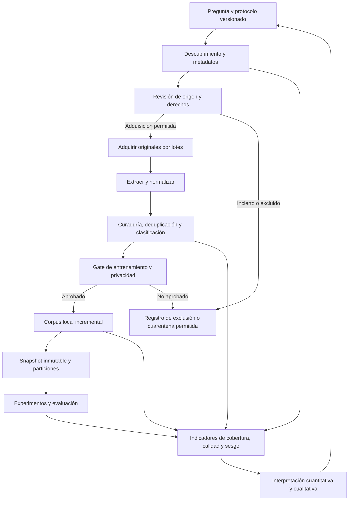

# Metodología de investigación reproducible

Amalia trabaja con evidencia versionada desde la etapa fundacional. El objetivo es que una persona o agente independiente pueda reconstruir cada decisión y repetir cada procedimiento, dentro de las restricciones legales y técnicas.

## Ciclo de investigación

1. Formular pregunta, hipótesis, fuente, alcance, criterio de evidencia y límites de recursos.
2. Estudiar fuentes primarias, registrar enlaces y revisiones exactas; separar lo declarado, lo observado y lo inferido.
3. Preparar y versionar scripts, comandos, configuración y dependencias. Revisar y probar sin red las funciones puras cuando corresponda. Fijar versiones antes de ejecución relevante.
4. Ejecutar con límites de volumen, coste, tiempo y permisos; registrar tanto éxitos como fallos. Si no es posible desde el entorno del agente, entregar al operador un comando reproducible contra el commit exacto.
5. Recibir, revisar y versionar evidencia compartible o su manifiesto. Conservar registros de exclusión, errores, cambios de configuración y limitaciones. No reemplazar silenciosamente resultados previos.
6. Resolver hallazgos con evidencia, actualizar decisiones y plan; solicitar revisión independiente cuando aplique. No presentar hipótesis o proyecciones como mediciones.

## Estructura mínima

- `tools/`: scripts exploratorios reutilizables, Python o sh según necesidad.
- `tests/`: pruebas de herramientas y pipeline.
- `docs/`: diseño, antecedentes, protocolos, referencias, decisiones y hallazgos.
- `evidence/`: resultados pequeños revisados y manifiestos de artefactos externos. Cada corrida tiene identificador y registro de procedencia.
- Configuraciones y dependencias se versionan junto a sus consumidores; no crear infraestructura extra antes de necesitarla.

## Evidencia por corrida

Registrar como mínimo ID, fecha UTC, Git SHA y estado limpio/sucio, versión/hash del script, dependencias efectivas, comando y parámetros, versiones y URLs de entradas, hashes disponibles, resultados, errores y limitaciones. En experimentos ML añadir semilla, hardware, presupuesto, métricas y checkpoints. Si un campo no se pudo verificar, declararlo. Para revisar un artefacto externo, conservar ubicación autorizada y hash sin filtrar tokens de acceso.

El Git SHA identifica el procedimiento, no congela una API mutable: conservar la revisión de la fuente, fecha y evidencia material permitida. No considerar registros de licencia como autorización automática. No publicar datos personales, credenciales, archivos restringidos ni contenido no autorizado. Pesos, corpus grandes y logs voluminosos permanecen en almacenamiento apropiado con manifiestos en Git.

## Revisión y avance

El trabajo se hace por incrementos pequeños, con protocolo, evidencia y decisiones enlazadas. El agente propone y la autoridad de control aprueba el alcance. El resultado negativo es evidencia válida. Toda revisión informa las pruebas realmente ejecutadas y los bloqueantes restantes. Los gates se cierran por resultados verificables, no por una opinión del agente. El plan MVP y el registro de revisiones siguen siendo la autoridad para el experimento específico.

Ejemplo inicial: [prueba M00](feasibility.md), [script](../tools/feasibility_probe.py) y [registro de revisiones](mvp-reviews.md).

## Compendio de investigación ejecutable: Amalia como laboratorio

Amalia adopta una síntesis propia de investigación computacional reproducible, ciencia abierta, métodos mixtos, investigación lingüística/social y experimentación ML. El repositorio, junto con los artefactos de datos referenciados, constituye un laboratorio ejecutable: el código no solo inspecciona fuentes, también produce progresivamente el corpus de investigación cuando la adquisición y uso están autorizados. El informe de factibilidad no sustituye los datos.

### Antecedentes adoptados

| Referencia | Principio incorporado |
|---|---|
| Gentleman y Temple Lang, Statistical Analyses and Reproducible Research (2007), recogido en [Research Compendia — The Turing Way](https://book.the-turing-way.org/reproducible-research/compendia/) | Integrar métodos, datos, código y textos en una unidad reproducible y ejecutable. |
| [The Turing Way](https://www.turing.ac.uk/research/research-projects/turing-way) | Ciencia abierta, diseño de investigación, colaboración y ética. |
| Mölder et al., [Sustainable data analysis with Snakemake](https://doi.org/10.12688/f1000research.29032.2) (2021) | Flujos explícitos, regenerables, transparentes y adaptables. |
| [Applying the FAIR Principles to computational workflows](https://doi.org/10.1038/s41597-025-04451-9) (2025) | Diferenciar especificación y ejecución; trazabilidad, metadatos, interoperabilidad, acceso condicionado cuando corresponda. |
| [DVC pipelines](https://doc.dvc.org/user-guide/pipelines/running-pipelines) | Dependencias, hashes y reconstrucción selectiva de resultados; posible herramienta futura. |
| Kandpal et al., [The Common Pile v0.1](https://proceedings.neurips.cc/paper_files/paper/2025/hash/52acc050138d6f40dad6f12f91a4ce22-Abstract-Datasets_and_Benchmarks_Track.html) (2025) | Corpus para LLM con código de adquisición/curaduría, mezcla y checkpoints publicados. |
| Fetters, Curry y Creswell, [Achieving Integration in Mixed Methods Designs](https://doi.org/10.1111/1475-6773.12117) (2013) | Integrar resultados cuantitativos y cualitativos en preguntas, muestreo, colección e interpretación. |
| Bender y Friedman, [Data Statements for NLP](https://aclanthology.org/Q18-1041/) (2018) | Documentar poblaciones, procedencia, contextos lingüísticos y límites de generalización. |
| Sen et al., [A Total Error Framework for Digital Traces](https://doi.org/10.1093/poq/nfab018) (2021) | Distinguir errores de representación y medición de fuentes digitales, sin equiparar disponibilidad con representatividad. |

No se afirma que Amalia cumpla una certificación FAIR ni que implemente Snakemake/DVC actualmente. Se adoptan principios, no una dependencia tecnológica obligatoria. El diseño específico siguiente es una propuesta de Amalia.

### Flujo de producción incremental

La unidad de trabajo es una investigación versionada relacionada con una fuente o pregunta. Cada ejecución de adquisición autorizada produce un lote local persistente y una evidencia de procesamiento, no únicamente estadísticas. El catálogo, los manifiestos, la curaduría y el corpus evolucionan conjuntamente.



El flujo se ejecuta por etapas; la retroalimentación científica no es un ciclo automático de entrenamiento. Los bucles corresponden a decisiones humanas o de autoridad supervisora documentadas. Un corpus local actualizado no sobrescribe el snapshot usado para una corrida anterior. Derechos de redistribución constituyen un gate separado antes de publicar.

### Contrato mínimo de un adaptador de fuente

- Entrada: identificador y revisión del registro de fuente, URL/endpoints, condiciones de acceso, revisión de permisos, filtros, límites y cursor/batch. Distinguir adquisición, conservación, procesamiento, entrenamiento y redistribución. Nunca intentar descargar contenido gated o prohibido sin autorización.
- Salida: metadatos originales permitidos, objetos originales permitidos y sus hashes, inventario por documento, incidentes/omisiones y cursor/cobertura. Cuando solo sea posible verificar metadatos, terminar con catálogo de candidatos y cero textos admitidos.
- Identidad: ID estable derivado de fuente e identificador original; conservar versión y hash de bytes, hash de texto normalizado, reglas y versión de extracción, vínculos entre objetos/documentos/derivados. No confundir un nuevo documento con una nueva edición.
- Incrementalidad: reanudar por lote, aplicar límites y registrar errores, evitar duplicados por ID/revisión/hash; actualizar mediante transacción o archivos temporales y renombrado; una corrida fallida no invalida lotes previamente completos. Distinguir caché de fuente mutable y snapshot; actualización de fuente debe ser explícita. Ejecuciones repetidas con los mismos insumos no añaden documentos duplicados.
- Revisiones: permisos y consentimiento pueden cambiar. Marcar versiones afectadas, bloquear nuevas admisiones, generar nuevas releases, identificar descendientes y aplicar retiro/retención según política. Inmutabilidad de snapshot no prevalece sobre obligaciones legales de eliminación.
- Salida a entrenamiento: únicamente textos con gate aprobado y manifiesto que fija IDs, versiones, hashes y asignación de split. Datos sintéticos, verbalizaciones y textos humanos se etiquetan por separado.

### Organización local propuesta

```text
amalia/
  docs/                 hipótesis, protocolos, decisiones y bibliografía
  tools/                exploración y herramientas ejecutables
  configs/              fuentes, muestreo, corpus y experimentos
  tests/                pruebas de componentes y datos de ejemplo
  evidence/             indicadores revisados y manifiestos publicados
  workspace/            almacenamiento local configurable, fuera de Git
    catalog/            inventario de fuentes y candidatos
    raw/                originales permitidos, por ID/version/hash
    quarantine/         material de tratamiento permitido aún no elegible
    processed/          extracción, limpieza, clasificación, linaje
    corpus/             conjunto elegible acumulativo
    snapshots/          manifiestos de corpus congelado y splits
    runs/               logs, métricas, errores, resultados y artefactos
```

Esta estructura define responsabilidades, no exige crear directorios vacíos o un framework ahora. `workspace/` es una propuesta de ubicación, configurable para usar otro disco; debe ignorarse en Git antes de usarla. No almacenar contenido sin derecho de adquisición/conservación bajo el pretexto de cuarentena. Git versiona métodos, configuraciones, manifiestos y resultados pequeños revisados; no todo el volumen de bytes. Un remoto o respaldo autorizado de blobs y manifests preserva entradas cuando la fuente cambia. Reconstrucción desde originales preservados, si es legal; si no, documentar irreproducibilidad parcial y procedimientos de acceso.

### Interfaz de ejecución prevista (aún no implementada)

Una CLI Python única, invocable en Windows/Linux, con acciones explícitas de discovery, ingest, prepare, status/report y snapshot. Los comandos no deben mezclar silenciosamente descubrimiento con descarga o publicación. `ingest` necesita registro autorizado, presupuesto local y límites de lote; `prepare` no promueve material incierto. `report` genera indicadores y evidencia vinculados a fuente, manifiesto y corrida. `snapshot` genera manifiesto inmutable de datos aprobados y conserva asignación de splits; no entrena ni publica. Priorizar JSONL/Parquet y Python, almacenamiento indexado sencillo si necesario. DVC/Snakemake se evalúan cuando coste de coordinación o necesidad de sincronización lo justifique; no son requisitos del primer adaptador.

### Integración de métodos científicos

| Disciplina | Decisión y evidencia esperada |
|---|---|
| Ingeniería informática | Procedimientos reproducibles, integridad, esquemas, tests, ejecución idempotente y linaje. |
| Estadística/probabilidad | Definir población objetivo y marco observable, unidad de análisis, muestreo, denominadores y estimandos; incertidumbre justificada, análisis de sensibilidad, controles pareados y potencia. |
| Ciencia de datos/ML | Distribución de tokens y documentos, duplicación, métricas de calidad y aprendizaje; controles, semillas, separación de splits y replicabilidad. |
| Investigación social y comunicación | Definir categorías interpretables, sesgos de selección y cobertura, instituciones/territorios ausentes, discursos, diversidad y relaciones de poder; análisis cualitativo de documentos y contexto de producción. |
| Lingüística/semiótica | Fenómenos pragmáticos y variedades, registros, significación y relaciones; rúbricas, anotaciones y desacuerdos; no inferir una identidad humana del modelo. |
| Ética/derechos | Procedencia, consentimiento, licencias y privacidad; revisar gobernanza y participación antes de ampliar. |

La muestra digital no equivale a la población argentina. Separar región de autoría, lugar de publicación, temática y comunidad lingüística; registrar desconocidos sin inventar etiquetas. Un conjunto de repositorios seleccionados por conveniencia no permite intervalos de confianza de cobertura nacional. Para inferencias dentro de un catálogo con marco conocido, definir muestreo probabilístico o estratificado, ponderaciones si proceden, unidades agrupadas y supuestos. Si no existe marco adecuado, reportar resultados descriptivos y límites. No forzar cuotas sin fundamento ni afirmar representatividad por equilibrio de tokens.

El análisis cualitativo investiga las causas de sesgos detectados cuantitativamente y puede orientar la próxima adquisición. Ejemplo hipotético: si predominan publicaciones académicas metropolitanas, revisar géneros y origen, solicitar nuevos documentos regionales y medir la cobertura posterior. La interpretación debe integrar cifras y observaciones, incluso si discrepan. Para anotación humana, fijar guía, selección de revisores, revisión de discrepancias y, si corresponde, acuerdo interanotador; no confundir consenso con verdad cultural.

### Retroalimentación documental

Cada reporte generado incluye IDs de corrida/fuente/snapshot, denominadores, conteos de metadatos y registros únicos, licencias declaradas vs aprobadas, motivos de exclusión, documentos y bytes, tokens por tokenizer/version, duplicados, distribución por región/época/género/idioma, calidad de extracción, proporción sintética y valores desconocidos. Solo computar métricas disponibles; no sustituir desconocidos por cero. Informes pequeños revisados y referencias se versionan. El reporte no modifica automáticamente el protocolo narrativo: el equipo interpreta resultados, registra decisión y propone nueva versión de hipótesis, adquisición o presupuesto. Mantener evidencia y texto enlazados mediante IDs y hashes, evitar números manuales sin fuente.

Exploración puede cambiar filtros y preguntas; confirmación exige preregistro/versionado previo de estimando, hipótesis, mezcla, splits, criterios, análisis y stopping. Cambios posteriores son desviaciones documentadas o nuevos experimentos. Reservar evaluación y no retroalimentar cuerpo de entrenamiento con tests confirmatorios.

### Primer incremento y aceptación

1. Ejecutar probe actual (solo metadatos/modelos, sin textos); conservar evidencia.
2. Seleccionar una fuente con derechos de adquisición claros y un lote pequeño revisado; diseñar/implementar adaptador reutilizable y configuración versionada.
3. Adquirir originales autorizados localmente, registrar hashes, extraer texto y generar corpus incremental de muestra. Evidencia y corpus deben ser salidas del mismo flujo.
4. Repetir la adquisición con igual configuración y comprobar que no duplica documentos; simular interrupción y reanudación; verificar que registros no aprobados no ingresan a corpus ni a publicación.
5. Generar reporte y snapshot piloto, reproducir transformación desde originales permitidos, comprobar hashes y taxonomía; documentar calidad, cobertura e incertidumbre. Revisar antes de añadir siguiente fuente.
6. Escalar gradualmente según [plan MVP](mvp-plan.md) y resultados; ningún entrenamiento ni publicación implícitos.

Criterio mínimo: un pequeño corpus real elegible en disco, persistente entre ejecuciones, con linaje verificable, reporte derivado, manifiesto congelado y pruebas de no duplicación y admisión. Ni un informe favorable ni un catálogo de metadatos equivalen a este resultado. No requiere construir una plataforma completa ni alcanzar 35M tokens para validar la arquitectura.
