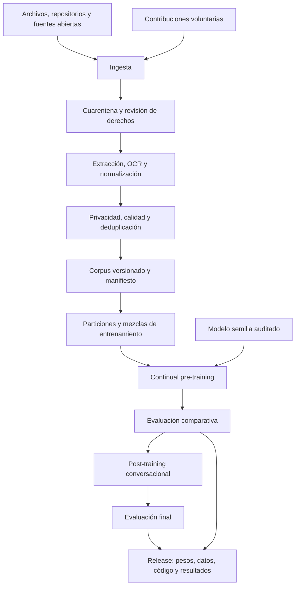

# Diseño técnico de Amalia

El [plan técnico del MVP](mvp-plan.md) detalla el protocolo operativo propuesto para Amalia 0.1 (en revisión); el horizonte de hasta 10M tokens es el laboratorio piloto, previo a cualquier ampliación confirmatoria. Ver también [antecedentes](state-of-the-art.md), [datos](data-sources.md) y [semillas](base-models.md).

Estado: propuesta fundacional, pendiente de validación experimental y jurídica. No describe infraestructura ya desplegada ni resultados obtenidos.

[README](../README.md) · [Roadmap](../ROADMAP.md) · [Agenda científica](research.md) · [Licencias y procedencia](licensing.md)

## 1. Qué pretendemos construir

Una familia de modelos de lenguaje abiertos y un laboratorio capaz de medir cómo incorporar patrimonio argentino modifica sus representaciones aprendidas. La primera versión reutilizará un modelo base pequeño, continuará su entrenamiento con un corpus local auditado y evaluará su evolución frente a controles. La capacidad conversacional se incorporará en una etapa posterior.

La unidad de investigación no es un chatbot ni una personalidad inducida por instrucciones, sino el efecto del corpus sobre los pesos del modelo y su comportamiento en ejemplos no vistos. El conocimiento general y la pluralidad se preservarán como objetivos explícitos. Los modelos podrán equivocarse y no sustituyen fuentes documentales.

## 2. Arquitectura lógica



Componentes lógicos, no microservicios obligatorios: corpus, entrenamiento, evaluación y publicación. Para el laboratorio, scripts Python y archivos locales son suficientes. Git versiona código, configuraciones y manifiestos; almacenamiento de objetos guarda volúmenes grandes cuando sea necesario. No construir el portal ni una plataforma distribuida antes de probar el circuito básico.

## 3. Modelo semilla

Evaluar Pleias 350M, 1.2B y 3B como candidatos iniciales; contrastar con alternativas (Comma, OLMo u otras) si ofrecen una mejor combinación de español, apertura, documentación y capacidad. No se elige definitivamente ninguna familia hasta auditar sus datos y licencias, incluyendo post-training si lo hubiera.

| Escala candidata | Uso |
|---|---|
| 350M | Verificar pipeline, entrenamiento y evaluación con coste reducido |
| 1.2B | Replicar y ampliar experimentos |
| 3B | Candidato conversacional V1 si la evidencia lo justifica |

Preferir un checkpoint base (no instruct) para aislar el efecto de entrenamiento continuo; fijar revisión, hash, tokenizer y configuración. Evaluar capacidad inicial en español, eficiencia de tokenización y soporte de entrenamiento. Un tokenizer heredado puede fragmentar variantes locales; primero medirlo, no sustituirlo sin experimentos controlados.

## 4. Corpus y procesamiento

### Fuentes piloto

- Legislación y documentación estatal: InfoLeg, datos abiertos y publicaciones institucionales.
- Bibliotecas, archivos y literatura histórica: Biblioteca Nacional, archivos provinciales, Wikisource y colecciones autorizadas.
- Producción académica: repositorios universitarios, SNRD, CONICET Digital y SEDICI; explorar OAI-PMH.
- Aportes contemporáneos y comunitarios: [Amalia Federal](federal.md) y futura convocatoria bajo CC BY 4.0 o CC0 cuando corresponda.

Son fuentes candidatas, no conjuntos autorizados por defecto. Acceso público no implica derecho a entrenar o redistribuir. La revisión por documento, el dominio público pagante, la privacidad y las obligaciones de atribución se rigen por la [política de licencias](licensing.md).

### Pipeline

1. Inventariar fuentes y guardar evidencia de procedencia y licencia; descargar solo cuando corresponda, conservando bytes y hash.
2. Clasificar documentos y extraer texto nativo de HTML, PDF, EPUB u otros formatos. Aplicar OCR a escaneos y medir sus errores sobre muestras.
3. Normalizar codificación, caracteres y estructura sin borrar voseo, regionalismos ni rasgos lingüísticos relevantes.
4. Identificar boilerplate, duplicados exactos y aproximados (hashes, MinHash/LSH cuando sea necesario), datos personales y contenido riesgoso; revisar falsos positivos. No eliminar automáticamente perspectivas históricas por su controversia.
5. Aprobar elegibilidad de entrenamiento y redistribución por separado. Mantener en cuarentena material incierto; no publicar textos ni metadatos privados.
6. Versionar los registros elegibles, medir tokens con el tokenizer seleccionado, documentar cobertura geográfica, temporal, lingüística y por género. Conservar trazabilidad de transformaciones.

Formato inicial: JSONL UTF-8 para intercambio y Parquet cuando el volumen lo justifique. Ejemplo ilustrativo de un registro aprobado (no documento real):

```json
{
  "document_id": "example-001",
  "source_url": "https://example.org/document",
  "author": "Autor de ejemplo",
  "license": "CC-BY-4.0",
  "license_evidence": "reference-to-reviewed-evidence",
  "jurisdiction": "AR",
  "content_sha256": "example",
  "language": "es",
  "region": "AR",
  "genre": "essay",
  "review_status": "approved",
  "eligible_for_training": true,
  "eligible_for_redistribution": true,
  "text": "Texto de ejemplo."
}
```

Mantener artefactos crudos y procesados separados. Deduplicar antes de dividir, agrupar por fuente/documento/autor cuando sea viable y reservar evaluación antes de entrenar. Registrar documentos excluidos sin publicar su contenido sensible. Usar diversidad como criterio de curaduría, no cuotas rígidas inventadas.

## 5. Primer laboratorio: entrenamiento continuo

### Experimento causal inicial

| Brazo | Datos | Propósito |
|---|---|---|
| A | Ningún entrenamiento adicional | Baseline original |
| B | Corpus general en español | Control de exposición adicional |
| C | Corpus argentino | Efecto de la exposición local |
| D (posterior) | Mezcla general/local | Explorar equilibrio y olvido catastrófico |

Para B y C igualar tokens procesados, pasos, batch efectivo, longitud de secuencia, optimizador y learning-rate schedule, y aproximar géneros, época y calidad de textos; documentar diferencias residuales. Usar misma revisión de semilla, tokenizer y hardware comparable. Evaluar antes y después sin instrucciones de identidad. Repetir con semillas aleatorias cuando el presupuesto lo permita.

Objetivo exploratorio: corpus pequeño de hasta 10M tokens únicos por brazo en F01, empezando con una muestra aún menor para el smoke test. Los tokens únicos y los tokens efectivamente procesados (incluidas repeticiones) se reportan por separado.

### Método

Continual pre-training causal con predicción del próximo token. Usar inicialmente actualización completa de pesos en la escala pequeña para responder directamente a la hipótesis; LoRA puede ser un brazo posterior de comparación, no un sustituto silencioso de ese método. Seleccionar learning rate mediante pilotos, registrar curvas de pérdida, gradientes, checkpoints y validación. Evitar prescribir hiperparámetros antes de medir estabilidad.

Stack candidato: Python, PyTorch, Hugging Face Transformers/Datasets; entrenamiento distribuido solo cuando se requiera, mediante Accelerate/FSDP u otro backend compatible. Seleccionar versiones y hardware después del smoke test. Publicar configuración, script, dependencias fijadas, semillas y logs. No entrenar por primera vez sobre un conjunto cuya licencia esté pendiente.

## 6. Evaluación

Amalia Bench combinará pruebas de conocimiento histórico, institucional y cultural, comprensión pragmática (voseo, ironía, expresiones regionales), lenguaje formal e informal, y capacidades generales.

- Modelos base: pérdida/perplejidad con tokenizer común, tareas de completado y opciones múltiples; no confundir capacidad de seguir instrucciones con aprendizaje cultural.
- Modelos conversacionales: preguntas reservadas, evaluación humana ciega con rúbricas, exactitud, naturalidad, calibración, alucinaciones y abstención.
- Regresiones: español general, conocimiento universal, razonamiento básico y programación según capacidad de la semilla.
- Identidad: medir diversidad de registros y regiones, evitar premiar estereotipos o una perspectiva ideológica única.
- Análisis interno opcional: comparar representaciones/activaciones sobre estímulos controlados sin inferir causalidad automáticamente.

Prefijar métricas y umbrales de éxito antes de las corridas confirmatorias. Reportar tamaño de muestra, incertidumbre, contaminación conocida y resultados negativos. Comparar frente a la semilla y brazos de control; modelos frontier podrán servir de referencia descriptiva, no de control causal.

## 7. Post-training y uso conversacional

Después de evaluar los checkpoints base, aplicar SFT con ejemplos de instrucciones y respuestas de procedencia compatible. Mantener datasets y versiones separados del preentrenamiento. Para comparar modelos conversacionales aplicar un SFT equivalente a los brazos elegidos. Evaluar utilidad, seguridad, veracidad, pluralidad y comportamiento ante instrucciones adversarias.

Un sistema RAG podrá aportar textos actualizados (por ejemplo normativa) con citas y fuentes. Es complemento de producto, no evidencia de conocimiento incorporado a los pesos. Mantener evaluación sin recuperación externa para el experimento principal.

## 8. Infraestructura y coste

| Fase | Propuesta |
|---|---|
| Ingesta y evaluación ligera | CPU local, almacenamiento local y Python |
| Smoke test y 350M | GPU local si cabe o una GPU alquilada; BF16 si soportado |
| 1.2B / 3B | GPU de mayor memoria o entrenamiento distribuido si justificado |
| Escala institucional | Clústeres GPU comerciales o académicos; validar compatibilidad y comunicaciones |
| Publicación | GitHub para código; Hugging Face u otro registro abierto para datasets y pesos |

Estimación de orden de magnitud para modelos densos: FLOPs de entrenamiento ≈ 6 × número de parámetros × tokens procesados. GPU-horas ≈ FLOPs / (rendimiento efectivo agregado de una GPU × 3600). Multiplicar GPU-horas por tarifa y sumar arranque, evaluación, checkpoints, reintentos, almacenamiento y egreso. La estimación no sustituye medición y no refleja por sí sola la memoria.

Ejemplo puramente ilustrativo: 350M y 10M tokens procesados requieren ~2.1e16 FLOPs; a 10 TFLOP/s efectivos equivale a ~0.58 GPU-horas de cómputo ideal para una corrida. Tres repeticiones o más, overhead, GPUs reales, pruebas y evaluación elevan el presupuesto. Medir tokens/segundo, VRAM pico, coste y horas reales antes de escalar. Los pesos BF16 de 350M ocupan ~0.7 GB, pero gradientes, optimizador y activaciones requieren memoria adicional.

No comprometer contratos ni clústeres antes de F01. Evaluar compatibilidad de dispositivos Intel/XPU y software antes de depender de infraestructura académica no CUDA.

## 9. Reproducibilidad y publicación

Cada experimento tendrá un ID, commit Git, hash de semilla, versiones de corpus/tokenizer, splits, configuración, hardware, dependencias, métricas, coste y checkpoints. Los artefactos voluminosos se mantendrán fuera del historial Git. Publicar data card, model card, resultados, atribuciones y limitaciones; documentar condiciones de descarga, inferencia y cuantización.

La apertura del modelo debe incluir la auditoría del entrenamiento heredado. No garantizar ausencia de reclamaciones ni etiquetar como abierto un artefacto que todavía no cumple las condiciones del proyecto.

## 10. Evolución hacia V1 y más allá

- F01: validar circuito mínimo de fuente autorizada a checkpoint evaluado.
- F02: replicar los brazos de control; analizar efectos culturales y regresiones.
- F03: seleccionar tamaño 1.2B o 3B según resultados, realizar post-training, publicar una V1 experimental con convocatoria de donaciones sujeta a revisión legal.
- F04: ampliar la red federal, el corpus y el benchmark.
- F05: evaluar otras semillas, 7B–12B, 32B–70B, arquitecturas MoE o entrenamiento desde cero. El corpus, los tests y la metodología deben ser reutilizables aunque cambien los pesos.

El escalamiento no consiste en continuar el entrenamiento de un 350M hasta convertirlo en un 70B: son arquitecturas y generaciones diferentes. La capacidad frontier será una aspiración de investigación, condicionada por datos generales, cómputo, post-training, calidad y equipo interdisciplinario, no una promesa por cantidad de parámetros.

## 11. Entregables del primer experimento

- Auditoría de la semilla y fuentes elegibles.
- Corpus piloto, manifiesto y particiones reproducibles.
- Script de entrenamiento y configuración versionada.
- Checkpoints A/B/C y registro de corridas.
- Benchmark piloto y reporte comparativo de resultados y limitaciones.
- Decisión fundamentada sobre la siguiente etapa.

Criterio F01: el circuito funciona y puede ser reproducido. Un resultado nulo no es un fracaso técnico. Los criterios de mejora y no regresión de F02/F03 se definirán antes de evaluaciones confirmatorias.

## 12. Referencias de implementación

- [Pleias](https://huggingface.co/PleIAs) y [Common Corpus](https://huggingface.co/datasets/PleIAs/common_corpus)
- [Common Pile](https://github.com/r-three/common-pile)
- [OLMo](https://allenai.org/olmo)
- [PyTorch](https://pytorch.org/) y [Transformers](https://huggingface.co/docs/transformers/)
- [Open Source AI Definition](https://opensource.org/ai/open-source-ai-definition)

Estas referencias orientan la investigación, no certifican derechos ni establecen versiones aprobadas.

Volver al [roadmap](../ROADMAP.md) o a la [agenda científica](research.md).

## Operación local de investigación

La [metodología del laboratorio ejecutable](research-methodology.md) complementa este diseño: cada fuente elegible puede aportar mediante un adaptador reproducible lotes incrementales locales, con etapas explícitas de descubrimiento, adquisición, curaduría, admisión, reporte y snapshot. El catálogo y las métricas sirven al diseño científico iterativo, no a un ciclo autónomo que altere el experimento confirmatorio. Priorizar CLI Python y almacenamiento local simple; orquestación y sincronización avanzadas quedan condicionadas al volumen/necesidad.
